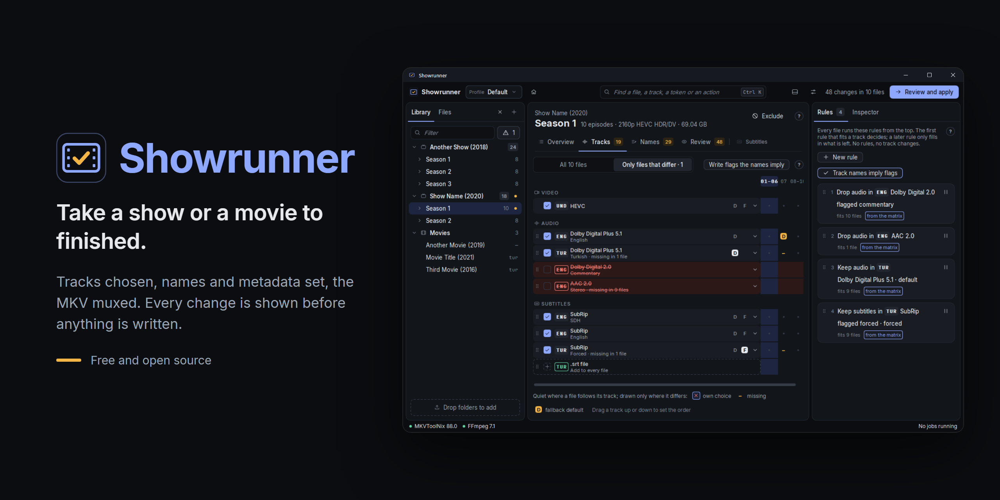
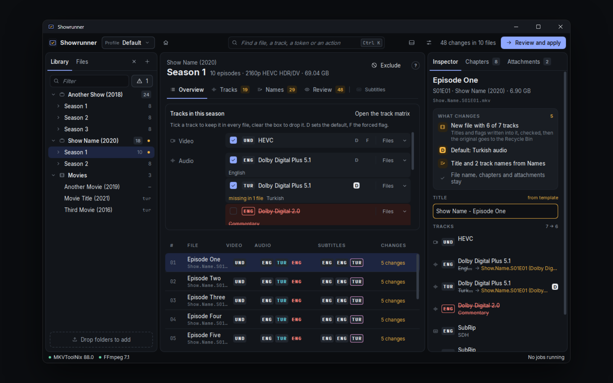
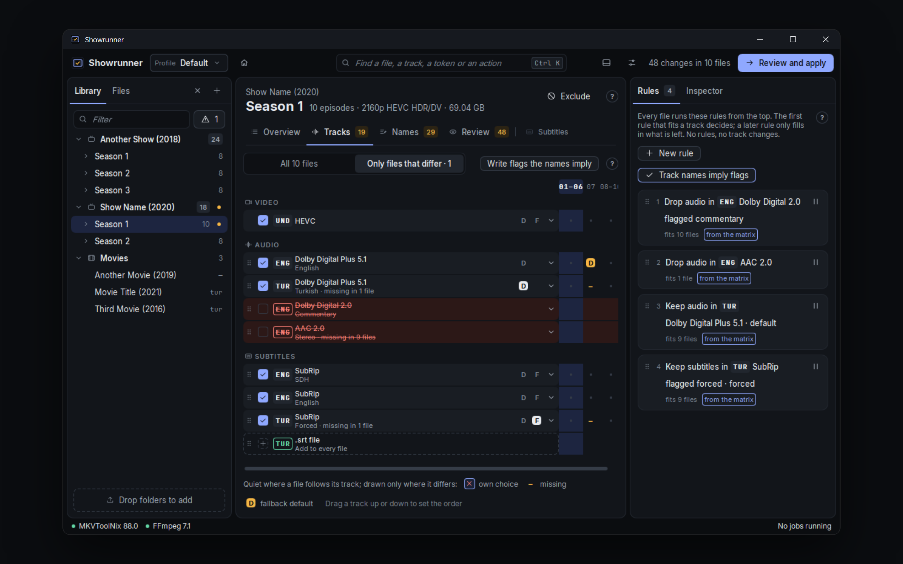
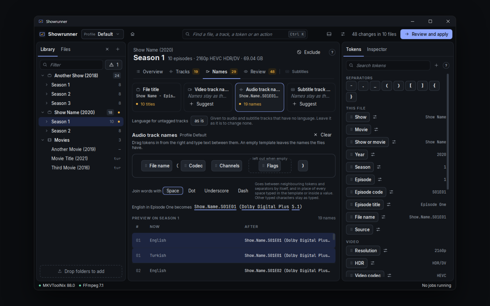
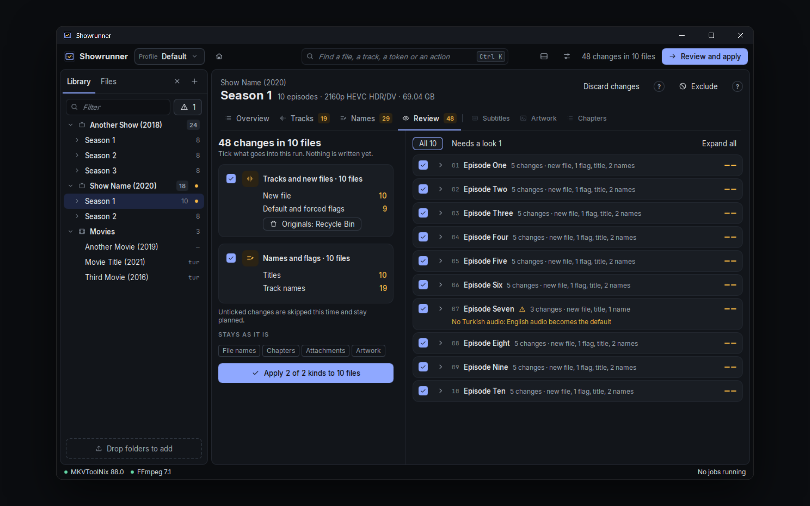

# Showrunner



**Take a show or a movie to finished. Every change is shown before anything is written.**

Showrunner is a desktop app for Windows that works through a whole show, season or movie library in one go. Drop a folder on it, say which tracks stay and what they and the file should be called, look at every planned change, and apply them. Nothing is written until you do, and your videos are never harmed: a file is either edited in its header only, or remuxed to a new file that is checked before the original goes to the Recycle Bin. Free and open source, GPL-3.0-or-later.

**Status:** Showrunner is young and has no release yet; run it from source (see [Run from source](#run-from-source)). It writes to your video files, so try it on copies first.

## Scan



Drop folders on the window, or add them with the **+** next to the Library. A show, its seasons and episodes, and movies (one to a folder or many in one) are told apart, and the first look at a place is Overview.

- **Shows, seasons, episodes and movies:** the library is a tree, with the number of files in each place. Videos that belong to no season are listed as extras of the show.
- **Subtitle files beside a video:** found and paired with it by title and episode number, and offered in Tracks as a track to add to the new file.
- **Every track at a glance:** video, audio and subtitles with language, codec, channels, HDR and flags, for a whole season at once. A track that only some files have says so (`missing in 1 file`).
- **Reopens fast:** what was read is kept, so opening the same folders again reads only the files that changed.
- **Find anything:** Ctrl+K searches files, tracks, tokens and actions.

## Tracks



Decide what each file keeps once, for the whole season, and see where a file differs.

- **Keep, drop, order, flag:** tick a track to keep it, clear it to drop it, drag it to set the order in the new file, and set which track is the default or forced one.
- **Rules instead of clicks:** "drop English commentary", "keep Turkish audio, default". A rule matches language, codec, channels, flags and name; the first rule that fits a track decides, and no rules means no track changes. Write your own or let the matrix make them.
- **Your own choice for a file:** open a track's chip to see which episodes have it and keep or drop it for one file. A season's choice reaches its episodes, a show's reaches its seasons, and the nearer place always wins.
- **Languages:** pick a track's language from a searchable list, or type a tag.

## Names



Set the title inside each file and the names of its tracks from templates you build out of tokens.

- **Chips you drag:** tokens such as show, year, season, episode, episode code, episode title, resolution, HDR, video and audio codec, channels and flags are read from the file; put them in any order and type text between them.
- **Live before and after:** the preview shows what the names are now and what they become, for the files you selected.
- **Optional parts:** a group of tokens can be left out when its value is empty, and Join words with picks space, dot, underscore or dash.
- **Your own tokens:** write a token with replacement rules for the values you want worded differently.
- **Empty means unchanged:** a template that is empty leaves the names the files already have.

## Review and apply



Everything planned is listed before anything is written.

- **Leave out what you do not want:** untick a kind of change or a single file, and it is skipped this time and stays planned.
- **Warnings in place:** a file that needs a look, such as a season that lacks the audio language you want as the default, is flagged on its row.
- **The header or a new file:** a change that only touches titles, names, languages and flags edits the file's header in place with mkvpropedit. A change to the tracks is remuxed with mkvmerge to a new file, checked, and then the original goes to the Recycle Bin or into a folder beside the video, as you choose.
- **Never lost half-way:** an applied run is a job. If the app is closed or crashes, the job is offered again at the next start, to resume or discard.

## Queue, profiles and themes

- **Queue:** right-click a show, season, episode or movie and add it to the queue. Each keeps the settings it had when added, and the queue runs them one after another; pause, cancel and retry work on what is left.
- **Profiles:** a profile is a saved set of rules, templates and settings ("TV default", "Movies"). Create, duplicate, rename, import and export them in Settings > Profiles; a batch starts from one and keeps its own copy.
- **Themes:** dark, light or follow Windows, with colors derived from a few base colors that you can change and export as a theme file to share or restore. The light theme has not been reviewed as closely as the dark one.
- **Compact density** for long seasons on small screens.

## Planned

These are written down in the design and not built yet; the tabs for them are greyed out in the window.

- **Subtitles:** pair, clean, sync (ffsubsync, alass), re-split onto the reference lines and translate with a local model (Ollama or llama.cpp), with a quality report and a built-in player to check the result.
- **Names of files:** rename files from a template, with episode titles from the file name or looked up online.
- **Artwork:** posters and covers as an attachment, and folder icons.
- **Chapters:** editing and renaming to a pattern.
- **Audio:** an optional E-AC3 copy of the first audio track.
- **Command line:** `showrunner-cli` only reports its version today; it is meant to do what the window does.
- **Packaging:** an installer for Windows.

## Requirements

- Windows, and Python 3.12 or newer to run it from source.
- [MKVToolNix](https://mkvtoolnix.download/) and [FFmpeg](https://ffmpeg.org/) are used to read and change files. Both are optional: Showrunner finds them on its own (its own tools folder, your PATH, the usual install folders), and a missing one turns off only the features that need it, with a note of which program would turn them on. Settings > Programs lists each one with its version and path, lets you point to your own copy, and can download one from its official source.

## Run from source

```powershell
python -m venv .venv
.venv\Scripts\activate
pip install -e ".[dev]"
```

```powershell
showrunner            # opens the main window (same as: python -m showrunner)
showrunner-cli --version
```

## Tests and lint

```powershell
pytest
ruff check
ruff format --check
```

Tests run Qt headless; no display is needed. `pytest` spreads the tests over worker processes, one per CPU core and at most eight ([pytest-xdist](https://pytest-xdist.readthedocs.io/)); each test gets its own data folder, so they do not meet. Tests that need MKVToolNix or FFmpeg skip when the program is missing. Named tests run in one process, and `-n 0` runs any selection there:

```powershell
pytest tests/ui/quick/test_remove.py::test_the_library_menu_closes_after_close_folder_empties_the_list
pytest -n 0 tests/ui/quick/test_remove.py
```

The same checks run on every push and pull request ([CI](.github/workflows/ci.yml)), on Linux with Python 3.12 and 3.14. The app is built for Windows, so tests of what only Windows has, such as the Recycle Bin, skip there.

## Contributing

Bug reports and ideas are welcome as [issues](../../issues).

## License

[GPL-3.0-or-later](LICENSE). Showrunner is free and open source.
